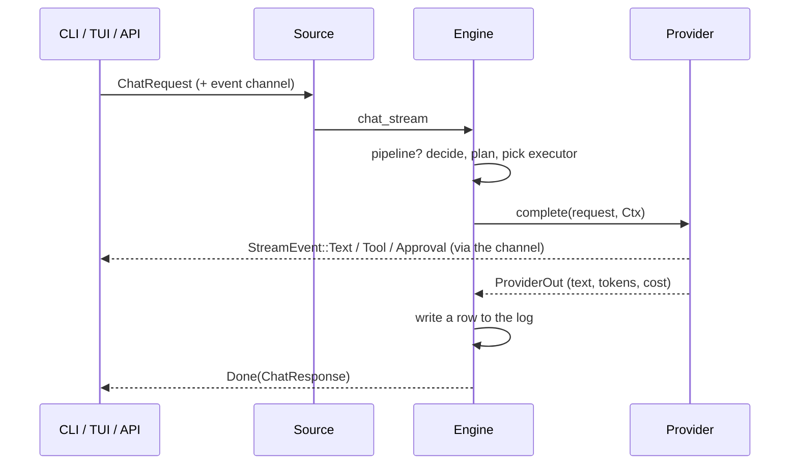

# Development

## Build, run, test

```powershell
cargo build                 # debug build
cargo test                  # unit tests (no network, no real models)
cargo run -- tui            # run without installing
cargo build --release
```

Tests cover: SSE parsing, the approval hub, Jev response parsing and the heuristic, Hermes `.env` lookup (and that a local key is never given to a remote host), the key store, and headless renders of the TUI (chat scrolling, live tool steps and approval popup, Settings, storing a key).

## Code layout

| File | Responsibility |
|---|---|
| `src/main.rs` | CLI (clap): all commands, the streaming chat printer |
| `src/config.rs` | config structs and defaults, validation, the flat key/value view used by `config set` and the TUI, env-name safety |
| `src/engine.rs` | the core: `chat` / `chat_stream`, budget checks, logging, and the **pipeline** (decide, plan, execute with fallbacks) |
| `src/provider.rs` | the `Provider` trait and every provider: Anthropic, OpenAI-compatible, Hermes (chat, runs, CLI), Claude Code CLI |
| `src/stream.rs` | `StreamEvent`, SSE parser, `ApprovalHub`, `Ctx`, `drive` |
| `src/jev.rs` | the decision `Verdict`, the heuristic, the Jev client |
| `src/router.rs` | simple/complex routing from a verdict |
| `src/check.rs` | setup/installation checks, pipeline roles, Hermes `.env` lookup, `which` |
| `src/secrets.rs` | private key store |
| `src/store.rs` | SQLite request log and aggregate queries |
| `src/server.rs` | HTTP daemon (axum): JSON, SSE, approvals, metrics |
| `src/source.rs` | `Source`: local engine or remote daemon, used by CLI and TUI |
| `src/tui.rs` | the terminal UI (ratatui) and its tests |
| `src/theme.rs` | UI preferences and theme |

## How a request flows



`Ctx` carries the event channel and the approval hub into the provider. Providers that return an answer in one piece don't need to stream: the engine emits the whole text for them.

## Add a provider

1. Add a `kind` string to the validation list in `Config::validate` (`src/config.rs`) and a default entry in `Config::default` if it should exist out of the box.
2. In `src/provider.rs`, write a struct that implements `Provider::complete(&self, req, ctx) -> ProviderOut`. Emit text with `ctx.text(...)`, tool steps with `ctx.emit(StreamEvent::Tool{...})`.
3. Add it to `provider::build`, and to `check::provider_ready` so the pipeline knows when it is usable.
4. If it needs a key, read it with `crate::secrets::get(name)` so shell variables and the stored key both work.
5. Add a mock-server test or a manual check, and a row to the [Providers](Providers) page.

## Add a setting

Add a field (with `#[serde(default)]`) to the right struct and its `Default` in `src/config.rs`. It then appears in `config show`, `config set` and the TUI automatically. Add one line to `help_for` so the TUI explains it.

## Testing against mocks

There is no need for real accounts to develop. The behavior was verified with small local mock servers (OpenAI-style SSE, Anthropic SSE, Hermes `/v1/runs` with an approval step, a fake Jev endpoint). To try the same: point a provider's `base_url` at your mock and use a throwaway `AIWS_HOME` so your real config and log are untouched:

```powershell
$env:AIWS_HOME = "$env:TEMP\aiws-dev"
```

## Style

- Match the surrounding code: small functions, comments only for the *why*.
- Never print or log a secret. Use `config::env_label` when showing an env-var name that came from user input.
- A feature that needs something optional must degrade, not fail: check readiness first (`check::provider_ready`), skip with a visible reason, continue.
