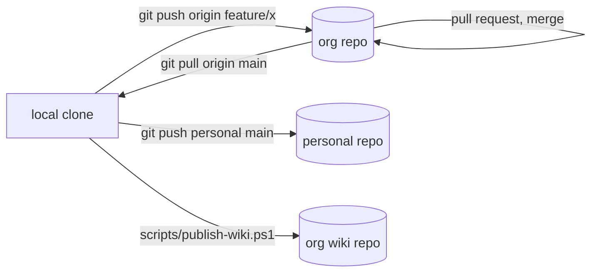

# Git Workflow

The project exists in two places: the **organization** repo (where features, issues, pull requests and this wiki live) and a **personal** repo that is kept up to date as a mirror. One local clone talks to both.



## One-time setup

Make the org repo `origin` and the personal repo `personal`:

```powershell
git remote rename origin personal               # if origin currently points at the personal repo
git remote add origin https://github.com/<org>/<repo>.git
git fetch origin
git branch --set-upstream-to=origin/main main
git remote -v                                   # check both are listed
```

If the org copy already has commits you lack, run `git pull --rebase origin main`. An import copies history, so the two repos share commits and this should be clean.

## Everyday flow

```powershell
git switch main
git pull origin main
git switch -c feature/my-feature

# ... edit, test ...
cargo test
git add -A
git commit -m "Add my feature"

git push -u origin feature/my-feature          # then open a pull request in the org
```

After the pull request is merged:

```powershell
git switch main
git pull origin main
git push personal main                          # keep the personal repo current
```

If the org allows direct pushes to `main`, push to `origin` first, then `personal`.

### Push to both with one command (optional)

```powershell
git remote set-url --add --push origin https://github.com/<org>/<repo>.git
git remote set-url --add --push origin https://github.com/<you>/<repo>.git
git push origin main
```

This fails if either repo has commits the other lacks, so the two named remotes are the safer default.

## Before every push

- `git status` lists only source files, `Cargo.toml`, `Cargo.lock`, docs, Docker files.
- `git diff --cached` has no keys, tokens, `.env` or `secrets.env`. The `.gitignore` blocks these, but check.
- `cargo test` passes.
- If a secret was ever committed, rotating it is mandatory; deleting the commit is not enough once pushed.

## The wiki

A GitHub wiki is a **separate git repository** next to the main one: `https://github.com/<org>/<repo>.wiki.git`. It is not updated by pushing the main repo, and it does not sync between the org and personal repos.

This project keeps the wiki pages as Markdown in **`docs/wiki/`** in the main repo (reviewable in pull requests, versioned with the code) and **publishes** them to the real wiki with a script.

### First time

GitHub creates the wiki repository only after the first page exists:

1. In the org repo enable **Settings, Features, Wikis**.
2. Open the **Wiki** tab and click **Create the first page** (any content, you will overwrite it).

### Publish

```powershell
./scripts/publish-wiki.ps1 -WikiUrl https://github.com/<org>/<repo>.wiki.git -DryRun   # shows what would be pushed
./scripts/publish-wiki.ps1 -WikiUrl https://github.com/<org>/<repo>.wiki.git            # pushes
```

The script clones the wiki, replaces its `.md` pages with those in `docs/wiki/`, commits and pushes. Pages deleted from `docs/wiki/` disappear from the wiki. Do not edit pages in the GitHub web editor, or the next publish overwrites the edit; change `docs/wiki/` instead.

### Editing docs

```powershell
git switch -c docs/update-hermes-page
# edit docs/wiki/Hermes-Setup.md
git add docs/wiki && git commit -m "docs: update Hermes setup"
git push -u origin docs/update-hermes-page      # pull request, merge
# then publish
```

Links between pages use the wiki form `[Text](Page-Name)`; `_Sidebar.md` is the navigation.

## Branch names

`feature/...` for features, `fix/...` for bugs, `docs/...` for documentation.
