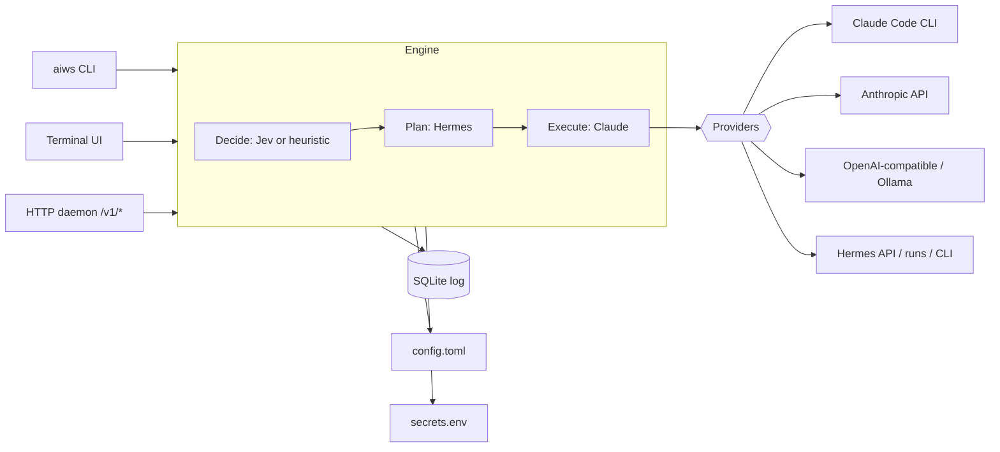

# aiws: AI CLI workstation

`aiws` is a single Rust program that lets you **use, monitor and combine AI models from the terminal**. It runs on your PC, on a server over SSH, or in Docker.

It gives you:

- **One entry point** for Claude Code (your subscription), the Anthropic API, OpenAI-compatible APIs (including Ollama), and Hermes Agent.
- **Monitoring**: every call is logged with tokens, cost, latency and why it was routed where it was. Budgets can stop overspending.
- **A terminal UI** to watch usage, read past requests, chat, and change settings without editing files.
- **A multi-model pipeline**: one model decides, another plans, another executes, and anything that is not set up is skipped automatically.
- **A daemon with an HTTP API** so other machines and tools can use the same setup.

## How the pieces fit

## Pages

| Page | What it covers |
|---|---|
| [Getting Started](Getting-Started) | Install, build, first run |
| [Providers](Providers) | Claude Code, Anthropic, OpenAI/Ollama, Hermes: what each needs |
| [Keys and Security](Keys-and-Security) | Where keys live, how to set them, what is never stored |
| [Hermes Setup](Hermes-Setup) | Turning on Hermes' API server, agent runs and approvals |
| [Jev Setup](Jev-Setup) | Status of Jev support and how to connect it |
| [Pipeline](Pipeline) | Decide, plan, execute, and the fallback rules |
| [TUI Guide](TUI-Guide) | Every tab and key |
| [Daemon and API](Daemon-and-API) | Endpoints, streaming, remote use, Docker |
| [Configuration Reference](Configuration-Reference) | Every setting and its default |
| [Development](Development) | Code layout, tests, how to extend |
| [Git Workflow](Git-Workflow) | Org repo + personal repo, publishing this wiki |
| [Troubleshooting](Troubleshooting) | Errors you may hit and their fixes |

## Status

Built and tested against mock servers: streaming, Hermes agent runs with approvals, the pipeline and its fallbacks, the key store, the TUI. **Not yet verified against real services:** Jev (its API is not public, so the client is an assumption), a live Hermes server, and the Anthropic API with a real key. See each page for details.
