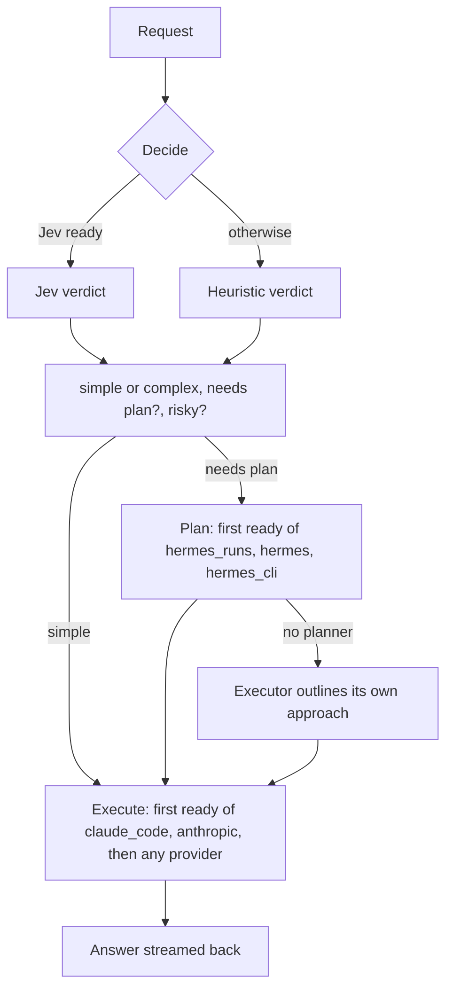

# Pipeline: decide, plan, execute

The pipeline uses several models on one request, each for what it is best at, and **degrades gracefully**: anything that is not set up is skipped and the request is still answered.



## Turn it on

```powershell
aiws config set pipeline.enabled true
aiws check          # shows which provider fills each role right now
```

It applies to requests **without** an explicit provider. `aiws chat -p anthropic "..."` always goes straight to that provider.

## The three roles

| Role | Default chain | What it does |
|---|---|---|
| **Decider** | Jev, else heuristic | Says: simple or complex, needs a plan, risky |
| **Planner** | `hermes_runs`, `hermes`, `hermes_cli` | Writes a short numbered plan. Only runs when a plan is needed |
| **Executor** | `claude_code`, `anthropic`, then any ready provider | Does the work, following the plan |

The planner's text is not shown as the answer. Its tool steps, plan lines (`plan| ...`) and approval prompts are shown.

## Fallback rules

| Situation | What happens |
|---|---|
| Jev off, unreachable, slow or low confidence | Heuristic decides; a note is shown only when Jev was configured but failed |
| No planner ready | The executor is told to outline its approach itself |
| A planner fails | The next planner in the list is tried |
| First executor not installed / no key | Skipped with a visible reason, next one tried |
| An executor fails before producing text | Next executor is tried |
| An executor fails after some text was already shown | Stops, so two answers are not mixed |
| `pipeline.fallback_any = true` and the listed executors are all unavailable | Any other ready provider answers |
| Nothing ready at all | Clear error pointing to `aiws check` |

## Models per size

When the executor is Claude Code, simple requests use `pipeline.simple_model` (default `haiku`) and complex ones `pipeline.complex_model` (default `sonnet`). This applies only to Claude Code; other providers use their own `default_model`.

## What you see

```text
  [decide [heuristic]: complex + needs plan + risky]
  [executor claude_code skipped: 'claude' is not installed or not on PATH]
  [planning with hermes]
  [plan| 1. Read the auth module ...]
  [executing with anthropic]
...answer...
[anthropic / claude-sonnet-5-5 | 11 in, 4 out tokens | ... | pipeline: heuristic:complex > plan:hermes > run:anthropic]
```

Each stage is logged as its own request (source `cli+pipeline`), so cost and latency per stage show up in the Requests tab and `aiws log`.

## Configuration

```toml
[pipeline]
enabled = true
planner = ["hermes_runs", "hermes", "hermes_cli"]
executor = ["claude_code", "anthropic"]
fallback_any = true
simple_model = "haiku"
complex_model = "sonnet"
```

In the TUI, list settings are edited as comma-separated text (`claude_code, anthropic`).

## Router vs pipeline

The older **router** (`router.enabled`) just picks a provider and model by simple/complex, with no planning step. If the pipeline is on, it takes over for requests without an explicit provider.
